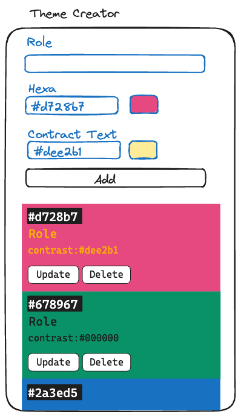

# Recap Project 4: Theme Creator

In this project, you will create an interactive Color Theme Creator app.

This is an individual project, so please create new project following this [guide to setup your repository](./docs/github-respository-template.md).

## Overview

In this project, we will create an Color Theme Creator app.
Users can add new color theme, edit and delete them. They can also copy the color hexa code of it.



## API

For issue `#7: Fetch API to Check If Contrast Is Okay`, you will be using [are my colors accessible api](https://www.aremycolorsaccessible.com/api-page).

```bash
https://www.aremycolorsaccessible.com/api-page
```

## Development

Requirements: Node 24 (`nvm use`).

```bash
npm install
npm run dev
```

- `npm run build` to build the app
- `npm test` to run the tests (`npm run test:watch` in watch mode)
- `npm run lint` / `npm run lint:fix` to run ESLint
- `npm run format` / `npm run format:check` to run Prettier
- `npm run typecheck` to check the types
- `npm run check` to run lint, format check and typecheck
- `npm run sync` to switch to `main`, pull and install dependencies if `package-lock.json` changed
- `npm run sync:branch` to merge `main` into the current branch (without committing) and install if needed
